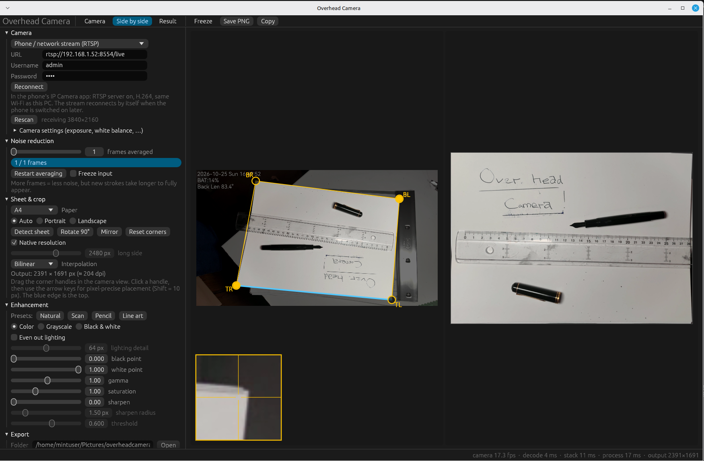

# Overhead Camera

**Draw on paper. Get a clean digital copy, instantly.**



Pen and paper are still the fastest way to think something through. Getting the sketch onto your computer is the
annoying part: a phone photo comes out skewed, shadowed and grainy, and a scanner interrupts your flow every time.

Overhead Camera turns a webcam above your desk, or the phone in your pocket, into a live scanner. Show it once where
your sheet lies, then simply keep drawing. On screen you see your page as if it had just come out of a scanner: flat,
sharp, evenly lit, and updated with every line you add. When you like what you see, one key press saves it.

### Why you'll like it

- **It's live.** No scan button, no waiting. The digital copy grows while you draw.
- **Flat and true to size.** The camera may look at the desk at an angle; the page is straightened and keeps its real
  proportions. An A4 sheet stays A4.
- **Better than the camera itself.** Many frames are combined into one to remove the grain of cheap webcams, shadows
  and yellowish light are evened out, and pencil lines become crisp with one click.
- **Uses what you already have.** An ordinary USB webcam works, and so does your smartphone over Wi‑Fi.
- **Ready to share.** Save or copy with a single shortcut and paste the sketch into a document, a chat or a slide, or
  hand it straight to an AI assistant such as Claude or ChatGPT to discuss it or build on it.
- **Private and free.** Everything runs on your own computer. No account, no cloud, no subscription,
  and the code is open source.

### Made for

Designers and engineers who think on paper, teachers and students working through a problem by hand, makers planning
their next build, and anyone who would rather show their sketch to an AI than describe it in words.

### Three steps

1. Point a camera down at your desk.
2. Right-click the four corners of your sheet in the camera picture, or let the app find the sheet for you.
3. Draw. Press **Ctrl+S** whenever you want to keep a copy.

Overhead Camera runs on Linux.

---

## Getting started

You need:

- **Linux** with a desktop. Windows and macOS are not supported (the app talks to cameras through Linux's V4L2).
- **A camera:** a USB webcam mounted above the desk, or a phone (see [Using a phone](#using-a-phone-as-the-camera)).
- **Rust** to build the app, installed with [rustup](https://rustup.rs).

Then:

```sh
git clone https://github.com/jonasfrey/overheadcamera.git
cd overheadcamera
cargo run --release
```

or install it as the command `overheadcamera`:

```sh
cargo install --path .
```

### Tips for a good picture

- Mount the camera as high and as straight above the sheet as you can. Any angle gets corrected, but a steeper view
  keeps lines sharper across the whole page.
- Bright, even light helps most. Soft shadows are removed by *Even out lighting*; hard shadows of your hand are not.
- Under *Camera settings*, switch exposure and white balance to manual so the image doesn't keep readjusting while your
  hand moves in and out of view.
- The *Sheet & crop* section shows the output size and its resolution in dpi. Around 150 dpi or more gives clean
  results.

### Using a phone as the camera

Any phone app that streams the camera as RTSP with H.264 video works. Tested with *IP Camera* by ShenYao on a Huawei
phone; [phoneascmaera/huawei_rtsp_setup.md](phoneascmaera/huawei_rtsp_setup.md) lists the settings.

1. Install GStreamer on the computer. On Ubuntu, Linux Mint and Debian:
   ```sh
   sudo apt install gstreamer1.0-tools gstreamer1.0-plugins-good gstreamer1.0-plugins-bad gstreamer1.0-libav
   ```
2. Start the RTSP server in the phone app (phone and computer in the same Wi‑Fi).
3. In Overhead Camera, pick *Phone / network stream (RTSP)* as the camera, enter the URL, username and password shown
   in the phone app, and press *Connect*.

If the phone is off or the stream drops, the app keeps retrying every few seconds and continues as soon as the phone
streams again. Exposure and focus are set in the phone app.

---

## Usage in detail

1. **Camera**: pick the device and mode (highest resolution is the default). Under *Camera settings* you can switch
   exposure and white balance to manual for a stable image. Changed values are remembered per camera and re-applied
   on start. The buttons above the camera image turn it (*Rotate 90°*), e.g. when the camera looks at the desk from
   the other side, or *Mirror* it for a camera that delivers mirrored pictures. The corners stay on the sheet:
   rotating leaves the result as it is, mirroring mirrors it too. The turn is remembered per camera.
2. **Sheet & crop**: right-click the four paper corners in the camera view, in any order; the first right-click
   starts a new outline, Esc cancels it. Or press *Detect sheet* for a bright sheet on a darker desk. Drag the corner
   handles (TL, TR, BR, BL) to adjust them, or click a handle and use the arrow keys for pixel-precise placement
   (Shift = 10 px); a loupe shows the magnified corner. The blue edge becomes the top of the output.
   *Rotate result 90°* / *Mirror result* change the orientation of the result. The paper format (A3–A6, US Letter, square, custom, or free from the
   corners; A4 by default) fixes the aspect ratio so the result isn't stretched.
3. **Noise reduction**: consecutive frames are averaged (temporal stacking). After the first *N* frames this turns into
   a running average, so new strokes keep appearing while you draw.
4. **Enhancement**: *Even out lighting* divides by an estimate of the bare paper brightness (removes shadows,
   vignetting, color casts), then black/white point, gamma, saturation, sharpening, and grayscale / black & white
   modes. Presets: *Natural*, *Scan*, *Pencil*, *Line art*.
5. **Export**: *Save* above the result (or Ctrl+S) writes `sketch_<timestamp>.png` into the export folder
   (`~/Pictures/overheadcamera` by default); *Copy* (or Ctrl+C) puts the result on the clipboard. The camera image has
   its own *Save* (`camera_<timestamp>.png`, full resolution) and *Copy*. *Freeze* (F) stops taking new frames, e.g.
   to tune the enhancement on a fixed image.

**Zoom**: scroll over the camera or the result view to zoom in around the pointer, drag to pan, and double-click to
see the whole image again. While zoomed in, a minimap in the corner shows where you are; click or drag in it to move
there. Zoomed-in views show the full resolution of the camera and of the result. In *Side by side*, drag the line
between the two images to give one of them more room; double-click it to center it again.

### Sharing with AI assistants

Every save also overwrites `latest.png` in the export folder with the saved image, scaled to at most 1568 px (AI models scale larger images
down anyway, and a smaller file uploads faster). To show your newest sketch to a coding agent such as Claude Code or
Codex, press Ctrl+S and tell it:

```
look at ~/Pictures/overheadcamera/latest.png
```

### Settings

Corners and all settings are saved on exit in `~/.local/share/overheadcamera/app.ron`. Corners are kept per source, so
switching between the overhead camera and the phone restores each one's crop. The stream password is stored there in
plain text.

---

## Under the hood

Rust + [egui](https://github.com/emilk/egui) (eframe). Cameras are read directly through V4L2 (MJPEG and YUYV); the
phone stream is received by running `gst-launch-1.0`, which hands decoded frames to the app as YUV4MPEG2. Decoding,
stacking and the perspective correction + enhancement each run on their own threads, so the interface stays smooth
even with 4K input.

| file | purpose |
|---|---|
| `src/main.rs` | window setup |
| `src/app.rs` | egui UI |
| `src/camera.rs` | device/mode discovery, capture thread, camera controls |
| `src/rtsp.rs` | phone / RTSP source: runs GStreamer, reads its YUV4MPEG2 output, reconnects |
| `src/pipeline.rs` | worker threads: JPEG/YUYV/I420 decode, stacking, rectify + enhance |
| `src/stack.rs` | frame averaging |
| `src/warp.rs` | homography + bilinear/bicubic perspective warp |
| `src/sheet.rs` | paper formats, orientation, output size |
| `src/enhance.rs` | lighting correction, levels, sharpening, color modes |
| `src/detect.rs` | automatic sheet detection |
| `src/img.rs` | image buffer types |

### Tests

```sh
cargo test                                                   # unit tests
cargo test --release -- --ignored --nocapture camera_smoke   # real camera, writes PNGs to the temp dir
OVERHEAD_TEST_DEVICE=/dev/video2 cargo test --release -- --ignored --nocapture camera_smoke
```

## License

Overhead Camera is created by Jonas Immanuel Frey. Copyright © 2026 Jonas Immanuel Frey.

This program is free software: you can redistribute it and/or modify it under the terms of the GNU General Public
License as published by the Free Software Foundation, either version 3 of the License, or (at your option) any later
version. See [LICENSE](LICENSE) for the full text.
